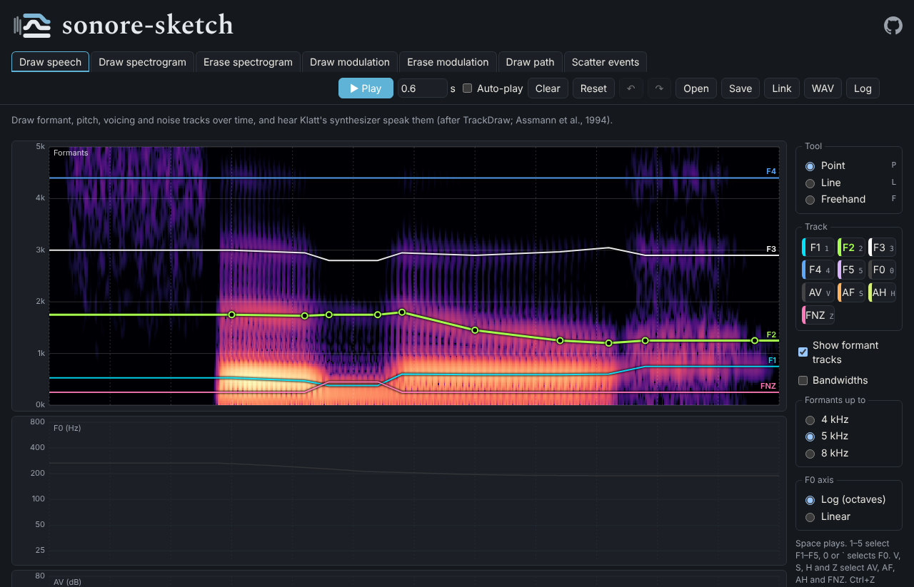
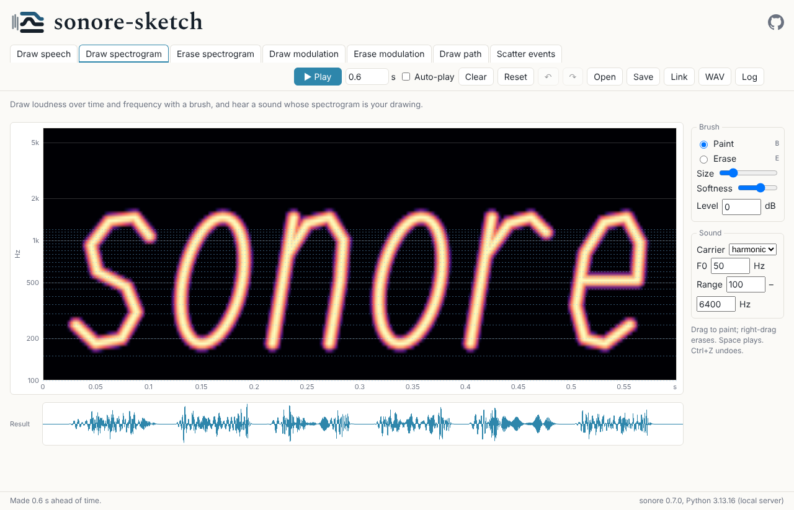
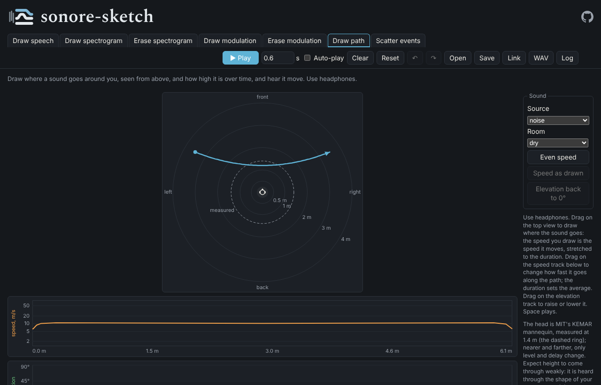

<h1><a href="https://choyun1.github.io/sonore/gallery/"><picture><source media="(prefers-color-scheme: dark)" srcset="docs/logo/sonore-sketch-banner-mark-dark.svg"></picture></a><picture><source media="(prefers-color-scheme: dark)" srcset="docs/logo/sonore-sketch-banner-name-dark.svg"></picture></h1>

[](https://github.com/choyun1/sonore-sketch/actions/workflows/test.yml) [](https://github.com/choyun1/sonore-sketch/actions/workflows/pages.yml) [](https://pypi.org/project/sonore/) [](pyproject.toml) [](LICENSE.txt)

**A visual front end for sonore's sound synthesis.**

sonore-sketch gives each of [sonore](https://github.com/choyun1/sonore)'s
routes back to sound a point-and-click surface: draw speech as formant and
pitch tracks, draw a spectrogram with a brush or a modulation spectrum with blobs, and hear
what sonore makes of it; or open a recording and erase parts of its
spectrogram or its modulation spectrum; or copy one short event at a drawn
rate and hear separate events pile up into a texture. sonore does the synthesis, in your
browser (Python under Pyodide); this project is only the interface.

**[▶ Try it in your browser](https://choyun1.github.io/sonore-sketch/)**: seven tabs, each a different
route to sound, with nothing to install.

**[▶ Listen to sonore's gallery](https://choyun1.github.io/sonore/gallery/)**: what sonore, the library
that makes every sound here, can do, each sound playable next to its plots.

<table><tr>
<td width="33%"><a href="https://choyun1.github.io/sonore-sketch/#tab=draw-speech"></a><br><sub><b>Draw speech</b>: formant, F0, voicing and noise tracks, spoken by Klatt's synthesizer</sub></td>
<td width="33%"><a href="https://choyun1.github.io/sonore-sketch/#tab=draw-spectrogram"></a><br><sub><b>Draw spectrogram</b>: a sound whose spectrogram is the painting</sub></td>
<td width="33%"><a href="https://choyun1.github.io/sonore-sketch/#tab=draw-path"></a><br><sub><b>Draw path</b>: a sound moving round your head, for headphones</sub></td>
</tr></table>

sonore-sketch is under active development, and so is sonore. A saved
drawing names the version that made it, but a later version may make a
different sound from it.

<!-- Contents: one entry per ## section, in order (tests/test_readme.py checks it). -->
<table><tr><td>

<small><b>Contents</b><br>
1&ensp;Using it<br>
&emsp;1.1&ensp;[The tabs](#the-tabs)<br>
&emsp;1.2&ensp;[Using the page](#using-the-page)<br>
&emsp;1.3&ensp;[The same sound in Python](#the-same-sound-in-python)<br>
2&ensp;Background<br>
&emsp;2.1&ensp;[How the sound is made](#how-the-sound-is-made)<br>
&emsp;2.2&ensp;[References](#references)<br>
3&ensp;The project<br>
&emsp;3.1&ensp;[Development](#development)<br>
&emsp;3.2&ensp;[Design documents](#design-documents)<br>
&emsp;3.3&ensp;[How sonore-sketch was developed](#how-sonore-sketch-was-developed)<br>
&emsp;3.4&ensp;[Credits](#credits)<br>
&emsp;3.5&ensp;[License and citation](#license-and-citation)</small>

</td></tr></table>

## The tabs

| Tab | You draw | You hear | State |
|---|---|---|---|
| **[Draw speech](https://choyun1.github.io/sonore-sketch/#tab=draw-speech)** | tracks over time: formants (F1–F5) and their bandwidths, F0, voicing (AV), frication (AF), aspiration (AH) and the nasal zero (FNZ) | the speech Klatt's (1980) synthesizer makes from them, after Track-Draw (Assmann et al., 1994) | built |
| **[Draw spectrogram](https://choyun1.github.io/sonore-sketch/#tab=draw-spectrogram)** | level painted on time × log-frequency | a sound whose spectrogram is the painting (sonore's `ripple_sound`) | built |
| **[Erase spectrogram](https://choyun1.github.io/sonore-sketch/#tab=erase-spectrogram)** | erasures on a sound's spectrogram (a syllable train, the Draw speech tab's sound, or a recording) | what is left of the sound (sonore's least-squares STFT resynthesis) | built |
| **[Draw modulation](https://choyun1.github.io/sonore-sketch/#tab=draw-modulation)** | blobs on a modulation spectrum (rate × density), and optional frequency bands | a sound with that modulation (sonore's `ModulationSpectrum.from_blobs`), confined to the bands | built |
| **[Erase modulation](https://choyun1.github.io/sonore-sketch/#tab=erase-modulation)** | erasures on a sound's modulation spectrum (a syllable train, the Draw speech tab's sound, or a recording) | the sound with that modulation taken out (sonore's `ModulationSpectrum.with_gain`) | built |
| **[Draw path](https://choyun1.github.io/sonore-sketch/#tab=draw-path)** | a path around the listener on a view from above, its speed along the path, and its elevation over time | the sound moving along it, one channel per ear, for headphones (sonore's `move_sound`, through the MIT KEMAR HRIRs; Gardner & Martin, 1995) | built |
| **[Scatter events](https://choyun1.github.io/sonore-sketch/#tab=scatter-events)** | the rate of one short event over time (a chirp, a tone pip, a noise burst or an impact), with sliders for the timing's regularity and the spread of levels and pitches | the copies, from single events to a texture (sonore's `event_train`), and how sparse each band's envelope is (sonore's texture statistics; McDermott & Simoncelli, 2011) | built |

## Using the page

Each tab's starting drawing plays at once: its sound is made ahead of time.
Your own drawings are made by Python, NumPy, SciPy and sonore in the browser,
which take several seconds to start on every visit even when the browser has
them cached (about 3 s of it is `import sonore`); the first visit also
downloads them. You can draw while they load. After that, a sound is made
each time you finish a change.

**On every tab**

- **Play** (or Space) plays the sound. Tick **Auto-play** to hear each
  change as soon as it is drawn (for sounds up to 3 s).
- The **duration** (up to 10 s) stretches everything drawn.
- **Undo** and **Redo** (Ctrl+Z, Ctrl+Shift+Z or Ctrl+Y) cover every change.
  **Clear** blanks the tab you are on (Draw speech, which cannot be
  silent, goes to a steady neutral vowel, a schwa), keeping the duration.
  **Reset** puts the tab back as it was when the page opened, or when you
  last opened a file or link, at that duration. Undo brings yours back
  after either.
- **Save** writes the drawing as JSON, **Open** reads it back, **Link**
  copies an address that opens it, and **WAV** saves the sound. A saved
  file or a link opens on the tab it was made on.
- Every sound is played and saved at the same peak level (−1 dBFS), so a
  change that only turns the whole sound down is not heard; erasing a
  loud part makes the rest louder.
- **Log** shows what the page did and any errors, with Python's traceback.
  Its **Copy** puts the log, the versions and the current drawing on the
  clipboard, for a bug report.

**Draw speech.** Select a track with its button, by clicking its line, or with
the keys 1–5 for F1–F5, 0 (or `` ` ``) for F0, and V, S, H and Z for AV, AF, AH and FNZ. The tools have keys too:
P, L and F. **Point** adds a breakpoint or drags one;
double-click removes it. **Line** replaces a span with a straight line.
**Freehand** draws a stroke, kept as the fewest breakpoints within a small
tolerance (Douglas & Peucker, 1973). With any tool, dragging a breakpoint's circle up or down moves
it; with Line or Freehand, dragging from a circle along time draws from it
instead. **Bandwidths** shows a strip for the selected formant's bandwidth, and the **F0 axis** can be
spaced in octaves (Log, from 20 to 800 Hz) or in Hz (Linear). **Formants up to** shows the formants and the spectrogram under them up to 4 kHz
(the most room for F1–F3), 5 kHz (the default, with F4 and F5) or 8 kHz, where most of the hiss of /s/ is. Unticking **Show formant tracks** hides
F1–F5 to show the spectrogram under them; they still shape the sound, and selecting one shows them again.
Draw speech starts with sonore saying its name. Its consonants come from three more tracks: **AF**
(frication, the hiss of /s/, through the high formants) and **AH** (aspiration, breath) in the Noise
strip, and **FNZ**, the nasal zero, drawn with the formants (raised above 250 Hz for /n/ or /m/).
Drawing AF in a drawing with the high formants' levels all off turns them on, at the /s/'s settings.

**Draw spectrogram.** It starts with "sonore" written by hand on the
harmonic carrier at 50 Hz. Drag to paint at the brush's level (0 dB is the
loudest); right-drag or **Erase** paints silence (B and E switch between
them). Size and Softness shape the brush. **Range**
sets the frequencies painted, 100–6400 Hz to start with; changing it keeps
what is painted inside the new range. The **carrier** is what the painting
shapes: log-spaced tones, harmonics of an F0, or noise. The harmonic
carrier sounds only at multiples of F0, which show as faint dashed lines;
paint between them is silent.

**Draw modulation.** It starts with one blob and one band, two octaves
wide round 500 Hz. The **Design** panels are what you draw: click the plane to
add a blob, drag it to move it, and drag its squares to change its width
and height (up to 8 blobs). **Add band** confines the sound to a band of
frequencies that you reshape on the spectrogram with Point, Line or
Freehand (P, L, F); Delete removes the selected blob, band or breakpoint. The **Result** panels are measured from the sound that came out:
its own modulation spectrum and its waveform, beside what you drew. The
carrier (tones, harmonic or noise), the modulation depth, and the seed
(**New draw** hears another random draw with the same spectrum) are below.

**Erase spectrogram.** Choose a **source**, as on Erase modulation: a
syllable train, the Draw speech tab's sound, or a recording (**Open audio
file…**); a recording opened on either tab can be the other's source too.
The plane shows the source's spectrogram from 0 Hz to half the sampling
rate, on a linear axis so harmonics are evenly spaced lines. Paint on it to
erase that part of the sound (right-drag or **Restore** brings it back);
**Erase**'s **Depth** goes down to -60 dB, which removes it (E and R switch
between Erase and Restore; Erase never makes something already erased
come back). The **Result** panel shows the spectrogram of what came out, in the same
window and on the same scale, with what you erased outlined, and its
waveform. When the duration changes, erasures on a recording or the
syllable train stay at their seconds (those sounds are not stretched),
while on the Draw speech sound they stretch with it.

**Erase modulation.** Choose a **source**: a syllable train made at the
page's duration, the Draw speech tab's sound, or a recording (**Open audio
file…**, which sets the duration to the recording's, up to 10 s). Each
sound made shows the source's modulation spectrum on the plane, with a
center strip for rates under 1 Hz. Paint on it to erase that modulation
(right-drag or **Restore** brings it back; E and R switch between them);
**Erase**'s **Depth** goes down to -60 dB, which removes it. The presets replace the mask: keep the rates
below some Hz, or remove the downward or upward sweeps. The **carrier** is
the source's own fine structure, tones or noise; **Iterations** search for
a sound whose own modulation comes closer to the edit, which the source's
own fine structure needs to be heard well. The **Result** panels show the
sound that came out: its own modulation spectrum, measured, with what was
erased outlined over it, its spectrogram and its waveform. When an edit needs
envelopes below zero, sonore clips them and a note under the plane says how
much. A recording is kept in saved files but never in links.

**Scatter events.** Choose the **event** and its knobs: a chirp (its first
and last frequency), a tone pip (its frequency) or a noise burst, each 10
to 100 ms long, or an impact, a noise burst that dies away (its **Decay**)
through a lowpass (its **Cutoff**: low for a knock, higher for a clap).
Drag on the rate track to draw how many copies come each second, from 1
to 1000 on a log axis; **Rate back to 10/s** makes it flat again, as does
Clear. **Regularity** goes from random (Poisson) timing at 1 to nearly
regular at 64, and **Level spread** and **Pitch spread** draw each copy's
level and pitch from a normal distribution. The sliders apply when you
let go; **New draw** hears another draw with the same settings. Under the
spectrogram, the envelope sparsity of each band, and the same statistic
against the rate for this event, with the sound's own value as a red dot
while its rate is flat.

## The same sound in Python

A saved drawing gives the same sound outside the browser:

```python
import json
from sonore_sketch import page

sound = page.synthesize(json.load(open("sketch.json")))
```

## How the sound is made

Every sound is made by sonore 0.7, in `src/sonore_sketch/` (one module per
tab). The design documents in `docs/design/` hold the measurements behind
each choice; this section is the method in one place.

### The common picture: envelopes and their modulation spectrum

The Draw modulation and Erase modulation tabs share one description of a sound.
A cosine filterbank (McDermott & Simoncelli, 2011) splits it into bands
1/12 octave wide from 100 to 6400 Hz. Each band is a slow **envelope** (its loudness over time, sampled
at 1 kHz) times a fast **fine structure** (what is under the envelope).
The envelopes form an array, band by time, and its 2-D Fourier transform
is the **modulation spectrum** (Chi et al., 1999; Singh & Theunissen, 2003): **rate** (Hz) along time and **density**
(cycles/octave) along frequency. A positive rate with a positive density
is a downward sweep, a negative rate an upward one, and density 0 is
modulation shared by every band.

The spectrum the plane shows is only the transform's magnitude. Two
phases are missing from it, and something has to supply them before
there is a sound again:

- the **modulation phase**: when each event happens and how the bands
  line up;
- the **fine structure** under each band's envelope.

The **carrier** is what supplies them. Every route back to sound below is
the same three steps: magnitudes (drawn or edited) and a modulation phase
make envelopes by the inverse 2-D transform; the envelopes multiply each
band's fine structure; the bands are summed. The result is normalized to
RMS 1.

### Draw speech

The tracks are parameters of Klatt's (1980) cascade/parallel formant
synthesizer, given as breakpoints and interpolated in time
(`so.klatt_synthesize`). There is no iteration.

### Draw spectrogram

The painting is read as an amplitude envelope over time and octaves,
bilinearly between cells, and `so.ripple_sound` puts it on a carrier, as
moving ripples are made (Kowalski et al., 1996), but with any envelope: 20
log-spaced tones per octave, the harmonics of F0 (weighted 1/√k for equal
energy per octave), or noise through a 1/24-octave filterbank. Each
component is multiplied by the envelope at its own frequency. A harmonic
carrier has components only at multiples of F0, so paint between them is
silent. There is no iteration.

### Erase spectrogram

The source is analyzed with a 32 ms Hann window every 8 ms
(`so.GaborFrame`). The mask is read at each coefficient, bilinearly in
amplitude, and multiplies it; `to_sound()` then gives the sound whose own
STFT is closest to the masked one (least squares; Griffin & Lim, 1984).
Neighboring coefficients overlap, so not every picture is a sound's
spectrogram, and the result panel shows what came back. With a 5 ms window
an erased band would come back at only −32 dB, which is why the window is
long (`docs/design/tabs/mask.md`, F-M2). There is no iteration.

### Draw modulation

1. **Magnitudes from the blobs.** Each blob is a Gaussian patch of power
   over log rate and density; the patches add, are mirrored so that
   (rate, density) and (−rate, −density) match (as every real envelope's
   spectrum does), and their square root is scaled so that the envelopes
   vary about a mean of 1 by the **depth** (the RMS of the envelopes about
   their mean). Every band gets the same mean: a drawing sets modulation,
   not a spectral shape (`ModulationSpectrum.from_blobs`).
2. **The modulation phase is drawn at random** from the seed. **New draw**
   changes the seed: the same spectrum, another sound.
3. **Envelopes** come from the inverse 2-D transform. They cannot go below
   zero, so a draw that would need it is refused, with the largest depth
   that fits; within 10% of the depth asked, the sound is made at that
   depth instead.
4. **Fine structure**: a steady tone at each band's center (tones), each
   band of a noise (noise), or each band of a harmonic complex on F0
   (harmonic). The envelopes multiply it and the bands are summed.
5. **Bands**, if any are drawn, are applied last as a time-varying filter:
   a 20 ms STFT whose gain is the band's level within half its width of
   its center, a raised-cosine skirt of 1/6 octave on each side, and
   −60 dB outside every band.

### Erase modulation

1. The source is analyzed as above, which keeps both the magnitudes and
   the source's own modulation phase.
2. The mask is a gain on the magnitudes: 0 dB keeps a cell, −60 dB removes
   it. It is read at each cell of the analysis (the center column covers
   rates under 1 Hz) and averaged with its mirror image
   (`ModulationSpectrum.with_gain`).
3. Envelopes are rebuilt from the edited magnitudes and the **source's own
   modulation phase**, so the sound keeps its timing wherever nothing was
   cut. Envelopes that come out below zero are clipped, and the note under
   the plane says how many; this is why boosting barely works and cutting
   does (`docs/design/tabs/edit.md`, E-M5).
4. The fine structure is the source's own, or tones, or noise, as chosen.

### Iterations

Putting envelopes on a fine structure is not the end of the story: a fine
structure that fluctuates within a band (noise, or a recording's own) adds
modulation of its own, so the sound, analyzed again, has a modulation
spectrum that differs from the target. **Iterations** search for a sound
that comes closer, as Griffin and Lim (1984) do for a spectrogram. Each
round:

1. analyzes the current sound through the same filterbank;
2. keeps its fine structure and its modulation phase;
3. imposes the target's magnitudes again (the drawing, or the edited
   source) to make new envelopes, clipped at zero;
4. puts those envelopes on that fine structure, and sums the bands.

Each round costs one analysis and one synthesis, so the page shows a
progress bar and drops a search when the drawing changes.

**On Erase modulation** (0–20, default 5) this is sonore's own
`to_sound(iterations=n)`, taken one round at a time. On the source's own
fine structure an edit is barely heard without it: removing every rate
above 4 Hz leaves 2.5 dB less power at 6–40 Hz with no iterations, 11.6 dB
with 5 and 14.7 dB with 20 (`edit.md`, E-M3).

**On Draw modulation** (0–10, default 0), without bands it is the same search.
With bands it goes back and forth between the two constraints
(`blobs._toward_blobs`): each round divides the envelopes by the gain the
bands gave them, so the bands' own shape and motion are not what the
blobs act on; imposes the blobs' magnitudes on what is left; multiplies
the gain back; and puts the bands on again. The blobs then shape the
modulation *inside* the bands. Ten rounds give back most of what the bands
cost the blobs (+3–7.5 dB on tones and +11–15 dB on noise, in how far the
measured result stands out where the blobs are drawn over where they
are not) and get 85–95% of
what 50 do, at a ceiling set by the bands' width
(`docs/design/tabs/bands.md`, K-M5 and K-M5a). On the harmonic carrier
iterations are offered only with bands: without them the harmonics that
share each band beat at F0 and pull the search away (K-M5b).

### Draw path

1. The stroke on the top view keeps the pointer's own timing, so how fast
   you draw is how fast the sound moves; it is stretched to the page's
   duration. Its points are put every 10 ms and smoothed with a 30 ms
   Gaussian, which takes out the speed changes the pointer adds at every
   screen frame (`docs/design/tabs/paths.md`, W-M2). The speed track
   under the top view starts as that drawn speed; drawing on it sets the
   speed along the path instead, from its start to its end (W7), scaled so
   the trip takes the duration and never slower than 1/20 of its fastest
   (W8).
2. Each point keeps its direction and distance around the listener (at
   least 25 cm from the head's center), and the elevation track lifts it
   on the sphere of that distance, from −40° to 90°, the range MIT
   measured.
3. sonore's `move_sound` renders the source along the path through the
   MIT KEMAR HRIRs (Gardner & Martin, 1995; `src/sonore_sketch/data/`):
   each ear hears the sound through its own smoothly changing delay and
   the HRIRs interpolated between measured directions. They were measured
   at 1.4 m only, so nearer and farther change only the level (1/r) and
   the delay, and their files leave out the travel time from 1.4 m, which
   the tab puts back so nearer paths render (W-M1).
4. The sound is made at 32 kHz rather than the page's 16 kHz, since the
   cues that change most with elevation lie above 8 kHz (W-M4). It is
   played and saved in stereo, both ears at one gain.

### Scatter events

1. The event is made with sonore's own functions (`exponential_chirp`,
   `pure_tone`, `gaussian_noise` under a Hann window; the impact is
   `gaussian_noise` under an exponential decay, through a causal
   4th-order Butterworth lowpass, `butter_filter`, so its onset stays
   sharp). It lasts eight time constants, and at least 50 ms.
2. sonore's `event_train` copies it. The intervals are drawn from a gamma
   distribution with mean 1 s and shape set by Regularity, and the drawn
   rate is `event_train`'s `rate_scale`, so the track is the rate in
   events per second at each moment. Each copy's level (dB) and pitch
   (cents) are drawn from normal distributions; a higher copy is also
   shorter, as a tape played fast is. The sound is brought to one RMS, since its
   power grows with the rate.
3. The plots measure the sound with sonore's texture model
   (`sonore.texture.TextureStats`) and read one of its statistics, each
   band's envelope variance over its squared mean (McDermott & Simoncelli,
   2011). The dashed line is Gaussian noise filtered by the event, the
   limit as the rate grows. The curve against rate is made once for each
   event, from 3 s renders at 1 to 1000 per second with random timing and
   nothing spread, and averaged over the event's own bands (those within
   10 dB of its strongest). It keeps how peaky the envelopes are and drops
   the events' timing.

### What the Result panels measure

The Result panels analyze the sound that came out the same way as the
plane: the same filterbank, envelopes at 1 kHz and the 2-D transform.
With bands, each band's envelope is first divided by the bands' gain and
weighted by it, so what is shown is the modulation inside the bands, the
same quantity the blobs draw, and the two can be compared directly.

## References

Assmann, P. F., Ballard, W. J., Bornstein, L., & Paschall, D. D. (1994).
Track-Draw: A graphical interface for controlling the parameters of a
speech synthesizer. *Behavior Research Methods, Instruments, & Computers*,
*26*(4), 431–436. https://doi.org/10.3758/BF03204661

Chi, T., Gao, Y., Guyton, M. C., Ru, P., & Shamma, S. (1999).
Spectro-temporal modulation transfer functions and speech intelligibility.
*The Journal of the Acoustical Society of America*, *106*(5), 2719–2732.
https://doi.org/10.1121/1.428100

Douglas, D. H., & Peucker, T. K. (1973). Algorithms for the reduction of
the number of points required to represent a digitized line or its
caricature. *Cartographica*, *10*(2), 112–122.
https://doi.org/10.3138/FM57-6770-U75U-7727

Gardner, W. G., & Martin, K. D. (1995). HRTF measurements of a KEMAR.
*The Journal of the Acoustical Society of America*, *97*(6), 3907–3908.

Griffin, D. W., & Lim, J. S. (1984). Signal estimation from modified
short-time Fourier transform. *IEEE Transactions on Acoustics, Speech, and
Signal Processing*, *32*(2), 236–243. https://doi.org/10.1109/TASSP.1984.1164317

Klatt, D. H. (1980). Software for a cascade/parallel formant synthesizer.
*The Journal of the Acoustical Society of America*, *67*(3), 971–995.
https://doi.org/10.1121/1.383940

Kowalski, N., Depireux, D. A., & Shamma, S. A. (1996). Analysis of dynamic
spectra in ferret primary auditory cortex. I. Characteristics of
single-unit responses to moving ripple spectra. *Journal of
Neurophysiology*, *76*(5), 3503–3523. https://doi.org/10.1152/jn.1996.76.5.3503

McDermott, J. H., & Simoncelli, E. P. (2011). Sound texture perception via
statistics of the auditory periphery: Evidence from sound synthesis.
*Neuron*, *71*(5), 926–940. https://doi.org/10.1016/j.neuron.2011.06.032

The Pyodide development team. (2021). *pyodide/pyodide* [Computer
software]. Zenodo. https://doi.org/10.5281/zenodo.5156931

Singh, N. C., & Theunissen, F. E. (2003). Modulation spectra of natural
sounds and ethological theories of auditory processing. *The Journal of the
Acoustical Society of America*, *114*(6), 3394–3411.
https://doi.org/10.1121/1.1624067
## Development

The page is static: `index.html` and the ES modules in `app/`, with no
build step and no JavaScript dependencies. The Python half, which the page
runs under Pyodide, is in `src/sonore_sketch/` (one module per tab,
`sources.py` and `shared.py`, which the tabs share, and `page.py`, which
the page calls). It needs sonore 0.7.

```
pip install -e ".[test]" playwright
python tools/serve.py             # the page at http://localhost:8000/
python -m pytest                  # the Python half, against sonore directly
npm test                          # the page's model (Node 20+, no packages)
python tools/check_page.py        # the page in headless Chromium
python tools/make_screenshots.py  # the README's screenshots, in docs/screenshots/
```

Open `http://localhost:8000/?engine=local` to run the synthesis in your
own Python instead of the browser: no download, and it works offline.
`tools/check_page.py` uses the local engine by default; add
`--engine pyodide` to test the page as visitors get it. CI runs all three
test commands on every pull request (`.github/workflows/test.yml`), and
`main` is published to GitHub Pages (`.github/workflows/pages.yml`).

The screenshots above are of each tab's example; retake them with
`tools/make_screenshots.py` when the header, the toolbar or an example
changes.

Six things to keep in step:

- The sonore version is pinned twice, in `pyproject.toml` and as
  `SONORE_VERSION` in `app/worker.js`.
- The worker loads NumPy, SciPy and sonore's wheel itself rather than
  sonore's dependency list (it leaves out matplotlib and soundfile), so a
  new sonore version needs `SONORE_WHEEL` in `app/worker.js` updated too,
  and any new dependency of sonore added to its `loadPackage` call
  (`tests/test_page.py` checks both).
- The synthesis server (`server/README.md`), once `SYNTH_SERVER` in
  `app/engine.js` names one, runs this repository's Python: update it
  whenever `src/sonore_sketch/` or the sonore version changes on `main`.
- Each tab's starting sound is made ahead of time in `app/examples/`, by
  `python tools/make_examples.py`. Run it again when a tab's starting
  drawing, its synthesis or the sonore version changes
  (`tests/test_examples.py` fails until then).
- `src/sonore_sketch/files.json` lists every module in
  `src/sonore_sketch/`, for the browser worker. A new module must be added
  there, or the page fails in the browser while the local engine still works
  (`tests/test_page.py` checks).
- The Draw path tab's HRIRs, `src/sonore_sketch/data/mit_kemar.npz`, are
  made by `tools/make_hrirs.py` from MIT's SOFA file; the worker fetches
  that file the first time the tab makes a sound.

## Design documents

Every tab is designed before it is built, in `docs/design/`: `app.md` for
the page as a whole, and `tabs/` for each tab (`tracks.md` for Draw speech,
`painted.md` for Draw spectrogram, `blobs.md` and `bands.md` for Draw modulation,
`mask.md` for Erase spectrogram, `edit.md` for Erase modulation, `paths.md`
for Draw path, `events.md` for Scatter events).
Each records the measurements behind it, made by the scripts in `tools/`,
and the decisions Cho made.

## How sonore-sketch was developed

sonore-sketch is developed the same way as sonore, together with Claude,
Anthropic's AI assistant (Claude Code), during 2026.

**What Claude did.** Wrote most of the code, tests and documentation,
delivered as pull requests; drafted the design documents; and wrote and
ran the measurement scripts in `tools/` behind them.

**What Cho did.** Decided what the page is for, which tabs it has and how
each one looks and behaves, chose among the options each design document
put forward, and reviewed and merged each pull request.

**How it is verified.** The Python half is tested against sonore directly,
the page's model under Node, and the page itself in headless Chromium, on
every pull request; every measurement a design rests on is made by a
script in `tools/` and recorded in `docs/design/`; and every sound can be
heard on the page.

## Credits

sonore-sketch grew out of TrackDraw (2016), by Adrian Y. Cho and Daniel R.
Guest, whose history this repository keeps; the Draw speech tab is after
Assmann et al.'s (1994) Track-Draw. Every sound is made by
[sonore](https://github.com/choyun1/sonore), by Adrian Y. Cho, running in
the browser under Pyodide (The Pyodide development team, 2021). The logo
is sonore's own (MIT), drawn from the spectrogram of sonore saying its name;
the banner above is sonore's with the longer name (`tools/make_banner.py`), and
its logo opens sonore's listening gallery. The name, in the banner and at
the top of the page, is set in Spectral SemiBold (The Spectral Project Authors; SIL Open
Font License, `app/fonts/OFL.txt`).

## License and citation

MIT; see [LICENSE.txt](LICENSE.txt). To cite sonore-sketch, use
[CITATION.cff](CITATION.cff); the *Cite this repository* button in the
GitHub sidebar gives the same citation in APA and BibTeX. Please cite
[sonore](https://github.com/choyun1/sonore#license-and-citation) too, which
makes every sound.
